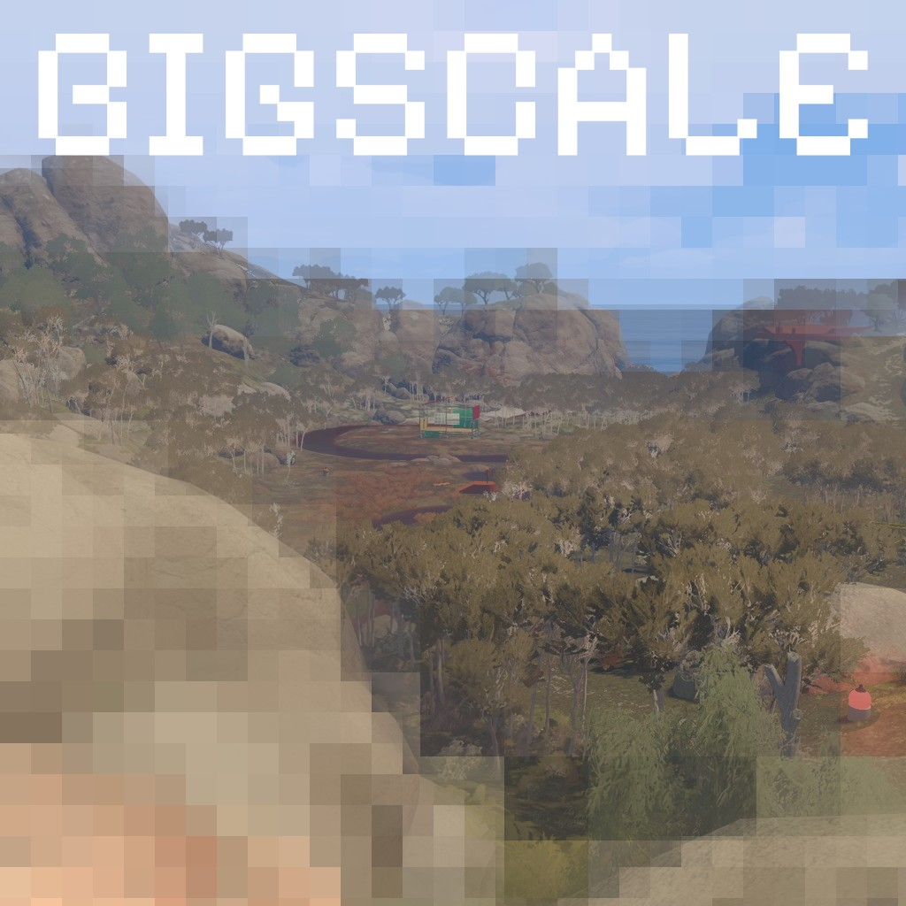
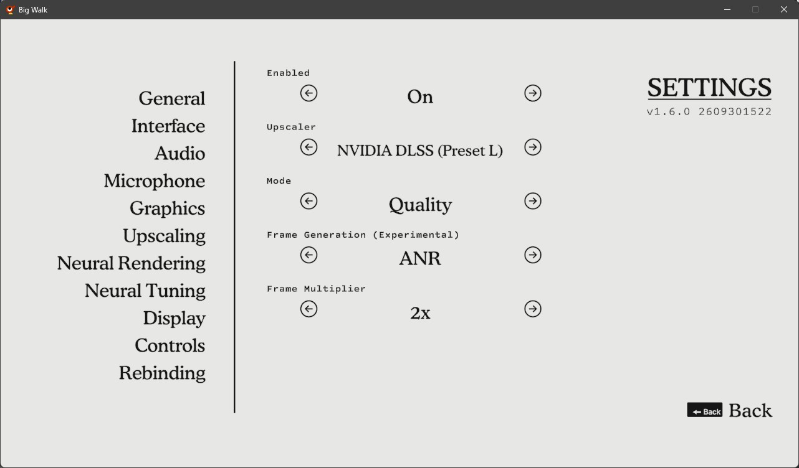
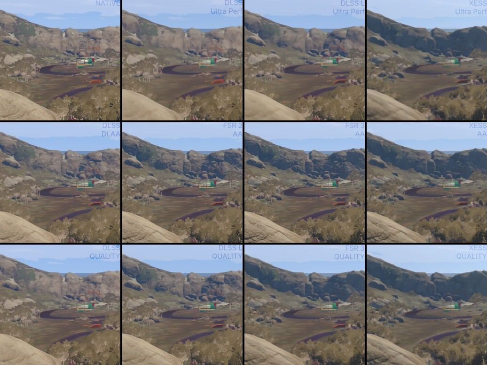
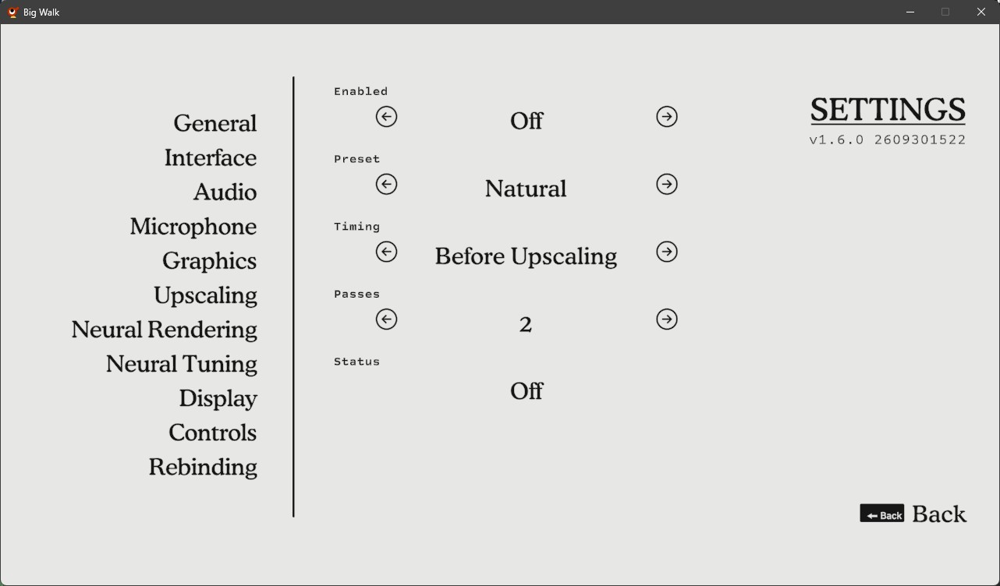

# BigScale

Temporal upscaling and optional frame generation for **Big Walk** (Unity 6, IL2CPP, Direct3D 11).
Replaces URP's temporal upscale with NVIDIA DLSS, AMD FSR 2/3/4 or Intel XeSS, controlled from an
in-game `Upscaling` settings category.

## Status

| Area | State |
|---|---|
| Desktop super resolution | Supported |
| Frame generation | Works, but experimental and currently has issues |
| DLSS5 Neural Rendering | Experimental and opt-in; requires a user-supplied runtime |
| Big Walk VR mod | Not supported; BigScale does not work with it, and it might never work |

> **Overlays:** Steam Overlay (Shift+Tab) and similar overlays may have issues with BigScale,
> especially when frame generation is enabled.

## Installation

1. Install **BepInEx 6 (IL2CPP)** for Big Walk, then launch the game once and close it.
2. Delete `BepInEx/plugins/BigWalkDLSS` if it exists. BigScale is a clean break and does not migrate
   old settings.
3. Unzip `BigScale.zip` from the Releases page into the game root so the files land in
   `BepInEx/plugins/BigScale/`.
4. Launch the game, open **Settings**, and select **Upscaling**.

## Usage

The `Upscaling` category has these rows:

- **Enabled:** master switch for upscaling and frame generation.
- **Upscaler:** NVIDIA DLSS, NVIDIA DLSS Preset L, AMD FSR 2, AMD FSR 3, AMD FSR 4, or Intel XeSS.
- **Mode:** Quality, Balanced, Performance, Ultra Performance, or Native AA.
- **Frame Generation (Experimental):** Off, NVIDIA, AMD FSR, Intel XeSS, or ANR.
- **Frame Multiplier:** 2x–6x; ANR is fixed at 2x.

Hold **TAB** in game for the status line. Settings are written to
`BepInEx/config/raharu.bigscale.cfg`; edit that file with the game closed.

## Recommended settings

This comparison does not fully represent the in-game difference.

| Goal | Recommendation |
|---|---|
| Best upscaling on NVIDIA RTX | **DLSS** |
| Best upscaling on supported AMD GPUs | **FSR 4** — not tested, but expected to be the best |
| Best upscaling on other GPUs | **XeSS** |
| Best frame generation for most users | **ANR** (manual install) |

## ANR frame generation (optional)

ANR is not bundled with BigScale.

1. Download the newest `anr-fg-*-addon.zip` from
   <https://github.com/apex-compute/ANR/releases/latest>.
2. Copy the contents of `Apex Neural Rendering FG/dlssg/` into
   `BepInEx/plugins/BigScale/providers/anr/` so that `providers/anr/nvngx_dlssg.dll` exists. Do not
   copy the add-on's other folders.
3. In **Settings → Upscaling**, set **Frame Generation** to **ANR**. OptiScaler and the ANR
   installer are not needed.

Selecting ANR starts it without a restart. After ANR has run, selecting another provider requires a
game restart.

## DLSS5 Neural Rendering (experimental)

BigScale can add an experimental NGX neural-rendering pass. It needs a runtime that BigScale cannot
redistribute:

1. Place the RTX 40-series fp16 `nvngx_dlssnr.dll` at
   `BepInEx/plugins/BigScale/providers/dlss5/nvngx_dlssnr.dll` (or beside `BigScale.Native.dll`).
2. Set `[DLSS5] Enabled = true` in `BepInEx/config/raharu.bigscale.cfg`, then restart the game. The
   in-game **Neural Rendering** and **Neural Tuning** settings appear only when this config gate is
   enabled.
3. Use **Neural Rendering** to turn the pass on or off and tune its preset, timing, strength, detail,
   and passes. **Character Masking currently does not work.**

If the runtime is missing or unusable, the status row reports `Runtime missing` and normal
upscaling and frame generation keep working.

## Optional runtimes

- **NVIDIA DLSS:** replace `BepInEx/plugins/BigScale/nvngx_dlss.dll` with the newest official build
  from <https://github.com/NVIDIA/DLSS/releases/latest>.
- Exact paths, switching rules, and removal steps: `_ADDITIONAL_PROVIDERS.txt`.

## Troubleshooting

The BepInEx log is `BepInEx/LogOutput.log`. For native provider problems, set
`[Diagnostics] NativeLog = true` in the config and restart; the native log is
`BepInEx/BigScale/native.log`.

## License

Apache License 2.0; see [`LICENSE`](LICENSE). Third-party notices are in `THIRD-PARTY-NOTICES.txt`.
